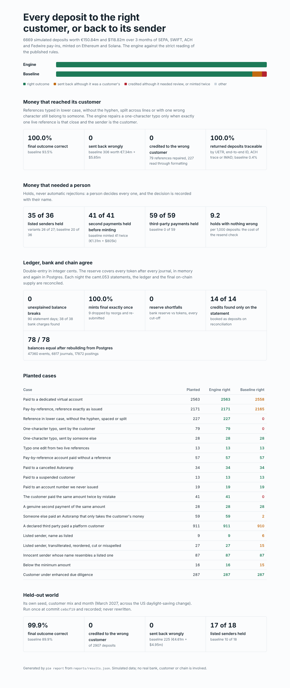

# stablecoin-payin-engine

**Fiat in, stablecoins out, in Rust: every deposit goes to the right customer or back to its sender, and
the books, the bank and the chain agree every night.**

This engine sits where traditional finance meets the chain in a stablecoin pay-in and issuance product:

- it reads the files banks actually send (ISO 20022 camt.054, pacs.008 and pacs.004, NACHA ACH,
  Fedwire tag-value, and camt.053 statements);
- it matches each credit to its Autoramp or returns it, screens the sender, and holds what a person
  must decide;
- it mints only against a funded, segregated reserve, follows the chain through reorgs, and
  reconciles bank, ledger and chain each night;
- it can find any deposit by whatever ID its sender quotes.

Postgres holds the record and the double-entry rules are enforced in the database too. The HTTP API
follows MoonPay Enterprise's published idempotency rules.

It runs against a simulated month of pay-ins with the mistakes senders and banks really make planted
in it. The engine never sees the planted answers; only the evaluation does.



## Why these problems

MoonPay Enterprise's public docs describe the operational edges of a pay-in product honestly:

- A deposit that matches no Approved Autoramp is returned to the sender. A pay-by-reference account
  paid without its `IR-XXXXXX` reference is one such case
  ([Autoramp](https://dev.enterprise.moonpay.com/autoramp.md)).
- "Returned deposits are not exposed through the API", so a missing deposit is traced by hand with
  its UETR, end-to-end ID, ACH trace number or IMAD
  ([Transaction status](https://dev.enterprise.moonpay.com/transaction-status.md),
  [Trace a missing deposit](https://dev.enterprise.moonpay.com/missing-deposit.md)).
- If a customer sends the money again while the first payment is in review, "a second payment
  creates a second transaction" ([Reviewing funds](https://dev.enterprise.moonpay.com/reviewing-funds.md)).
- USD mints and burns run in a window, Monday to Friday, 21:00 ET the day before to 17:00 ET.
  Reserves are segregated, and every token is backed at least 1:1
  ([Create your stablecoin](https://dev.enterprise.moonpay.com/issuance/create-your-stablecoin.md)).

The **baseline** in this repository is the strict reading of those rules (`config/baseline.json`):

- exact references only;
- exact-name screening;
- no check for second payments;
- returned deposits not traceable.

The **engine** (`config/engine.json`) is what I would build on top of them. Both run on the same code;
only the settings differ.

## Results

Three dev worlds give 6,669 deposits worth €150.84m and $118.82m. The numbers come from
[`reports/REPORT.md`](reports/REPORT.md), which `pie report` generates.

| | Engine | Baseline |
|---|---|---|
| Final outcome correct | 100.0% | 93.5% |
| Credited to the wrong customer | **0** | 0 |
| Sent back although it belonged to a customer | 0 | 306 (€7.34m + $5.85m) |
| Credited although it should have been held or returned | 0 | 112 (€2.88m + $1.78m) |
| Accidental second payments minted twice | 0 | 41 (€1.31m + $805k) |
| Listed senders held | 35 of 36 | 20 of 36 |
| Third-party payments held | 59 of 59 | 0 of 59 |
| Returned deposits findable by UETR / end-to-end ID / ACH trace / IMAD | 264 of 264 | 2 of 472 |
| Credits found only on the statement, recovered | 14 of 14 | 0 of 14 |
| Holds a person cleared with nothing wrong, per 1,000 deposits | 9.2 | 0 |

**What the engine costs.** The resend check holds real second invoices of the same amount, about nine
in every thousand deposits, and a person clears them. That is the price of never minting a customer's
accidental second payment.

**The one dev miss.** One listed name went through screening: "Caspian Ltd", a variant of the listed
"Caspian Bridge Finance Ltd" that keeps one distinctive word. The deposit was still held, as a
third-party payment, and rejected. Holding every sender called "Caspian" would flood the queue, so the
screen does not try.

### Ledger, reconciliation and chain

- **Ledger.** The trial balance is zero after every journal. The reserve never fell below the tokens
  outstanding plus those being minted; the lowest headroom was exactly 0.
- **Reconciliation.** 90 statement days reconciled:
  - 0 unexplained balance breaks;
  - 0 reserve shortfalls against the bank's own reserve balance;
  - 0 differences between ledger tokens and final on-chain supply;
  - 38 of 38 bank charges found.
- **Reorgs.** 9 mints were dropped by reorgs and re-submitted, and 12 were re-included. Every completed
  mint is final on-chain exactly once (6,353 of 6,353).
- **Bank files.**
  - 89 of 89 re-sent bank notifications ignored.
  - 6 of 6 corrupt files (a truncated ACH file, a cut-off camt.054) quarantined whole.
  - Every deposit booked exactly once.
- **Mint window.** No USD conversion ran outside the window. Booking to final mint takes p50 1.2 h for
  EUR, and p50 0.7 h / p90 4.4 h for USD, which waits for the window.
- **Postgres.** The dev month went in as 47,360 events, 6,817 journals and 17,872 postings, with the
  balance and reserve triggers on, at about 2,700 events/s. The engine rebuilt from the event log
  matches the database on all 78 balances (`reports/replay_pg.json`).

### Held-out world

The held-out world has its own seed, customer mix and month: March 2027, across the US daylight-saving
change. It was pinned before the engine ever ran on it and recorded once, at commit `cebcf19`
([`first_run.json`](reports/heldout/v1/first_run.json)):

| | Engine | Baseline |
|---|---|---|
| Deposits | 2,907 | 2,907 |
| Final outcome correct | 2,906 of 2,907 | 89.9% |
| Credited to the wrong customer | 0 | 0 |
| Sent back although it belonged to a customer | 0 | 225 (€4.61m + $4.95m) |
| Accidental second payments minted twice | 0 | 25 |
| Listed senders held | 17 of 18 | 10 of 18 |

The one held-out miss is a listed-name variant that was credited. By the held-out rule I have not
looked at which name it was or why; that would turn the set into a training set.

The held-out world comes from the same generator with a different seed and mix. It tests new
customers, references, amounts, dates and proportions, not kinds of mistake the generator cannot make.

## How it works

```
 bank files ──► rails/ ── parse or quarantine ──► routing ──► checks ──► hold? ──► person decides
 (camt.054, pacs.008,      (control totals,          │          (sanctions,          │
  NACHA, Fedwire,           entities, versions)      │           EDD, third party,    ▼
  pacs.004, camt.053)                                 │           second payment)   conversion
                                                      ▼                               │ USD waits for
                                                 return to sender                     │ the mint window
                                                 (traceable)                          ▼
                       ledger: deposit → held → reserve + pending mint ──► chain indexer
                       (balanced, reserve ≥ tokens, after every journal)    (confirmations,
                                                                             reorgs, re-submit)
 camt.053 ──► reconciliation: statement ↔ ledger ↔ final on-chain supply, open items carried forward
```

- **Rails** (`src/rails/`): one parser and one writer per format. Bank-specific spellings are read
  (party names with or without `Pty`, IBANs with spaces, entity references).
  - A NACHA file whose control totals do not match its entries is refused whole, and so is a
    truncated one.
  - A Fedwire drawdown is not a deposit.
- **Routing** (`src/routing.rs`):
  - A dedicated virtual account matches its Autoramp.
  - A pay-by-reference account is read the way a person reads it: any case, with or without the
    hyphen, spaced or split across lines.
  - A typo is repaired only when the whole reference word is one edit from exactly one live
    reference and the sender is the customer. Everything else is returned, and the trace API can
    find it.
  - A property test found an early version could drop a wrong last character to make a match. Fixed,
    and now tested on 5,000 random typos (`tests/properties.rs`).
- **Names and screening** (`src/names.rs`, `src/screening.rs`): legal forms and diacritics are
  removed, transliteration variants come from config, and names are scored with Jaro-Winkler on
  sorted tokens plus a token-set score.
  - ACH company names arrive cut at 16 characters, so they are also screened against listed names
    cut to the same length.
  - A hit is a hold, never a rejection.
- **Ledger** (`src/ledger.rs`): integer minor units, debits positive.
  - The deposit, the reserve sweep and the pending mint are one journal, so the reserve rule is
    checked on the result.
  - Postgres repeats both checks as deferred constraint triggers (`migrations/001_schema.sql`).
- **Chain** (`src/chain.rs`): blocks are released only after the configured confirmations (12 on
  Ethereum, 32 on Solana) and reorgs are followed back to the common ancestor.
  - A mint missing from the canonical chain after an hour is re-submitted under the same ID, which
    the issuer contract refuses to execute twice.
- **Reconciliation** (in `src/engine.rs`):
  - Each statement is matched entry by entry: credits, sweeps, returns, payouts and payout returns.
  - Unbooked items (bank charges) are carried forward as open items.
  - A credit seen only on the statement is booked as a deposit.
  - The bank's reserve balance is checked against the tokens at the cut-off.
- **Record and API** (`src/store.rs`, `src/api.rs`):
  - Every input is appended with the journals it produced, in one transaction, and memory is rebuilt
    from the log.
  - Every POST needs an `Idempotency-Key`, under MoonPay Enterprise's published rules: same key and
    same request replays the stored response, a different request is 409, failures store nothing.
  - A second request arriving while the first is still in flight gets a 409.
  - A decision on a hold needs the name of the person making it.

## Run it

```bash
cargo test                       # parsers, routing, ledger, chain, whole months, properties (~10 s)
cargo run -- evaluate            # dev worlds, engine and baseline -> reports/results.json
cargo run -- report              # reports/REPORT.md and reports/dashboard.html
cargo run -- heldout --rerun     # the held-out world again -> reports/heldout/v1/latest.json

# With Postgres
export PIE_DATABASE_URL="host=localhost user=postgres dbname=pie"
cargo test --test pg             # database rules, idempotency, concurrency, rebuild
cargo run -- replay-pg --db "$PIE_DATABASE_URL"
cargo run -- serve --db "$PIE_DATABASE_URL"
cargo run -- sample-files        # a day of bank files in data/sample to post
curl -s -X POST localhost:8080/api/bank-files -H "Idempotency-Key: $(uuidgen)" \
     -H "X-File-Name: f.xml" --data-binary @data/sample/<camt054 file>
curl -s localhost:8080/api/trace/<UETR | end-to-end ID | ACH trace | IMAD>
curl -s "localhost:8080/api/holds?open=true"
curl -s -X POST localhost:8080/api/holds/<hold-id>/decision -H "Idempotency-Key: $(uuidgen)" \
     -d '{"decision":"release","by":"A. Analyst"}'
```

## Limits

- **Simulated data.** No real bank, customer or chain is involved. Nothing here is MoonPay's code or
  data; only the public API vocabulary is borrowed. The sanctions list is invented.
- **Screening is by name only.** It uses no dates of birth, nationality or addresses, and there is no
  list-update pipeline.
- **One process.** The API serialises inputs through one engine behind a lock. Scaling out would
  partition by bank account and keep one writer per partition.
- **Not modelled:**
  - FX (deposits mint a token in their own currency);
  - US bank holidays in the mint window;
  - Travel Rule messaging (an unregistered wallet is simply held);
  - fees on the customer side.
- **The held-out world shares the generator** with the dev worlds (see above).

## Layout

`src/rails/` formats · `src/routing.rs` · `src/names.rs` · `src/screening.rs` · `src/ledger.rs` ·
`src/lifecycle.rs` · `src/chain.rs` · `src/engine.rs` · `src/store.rs` · `src/api.rs` ·
`src/sim/` world, bank, chains, operations desk and truth · `src/eval.rs` · `src/report.rs` ·
`config/` settings and worlds · `migrations/` schema · `tests/` · `reports/` generated.
